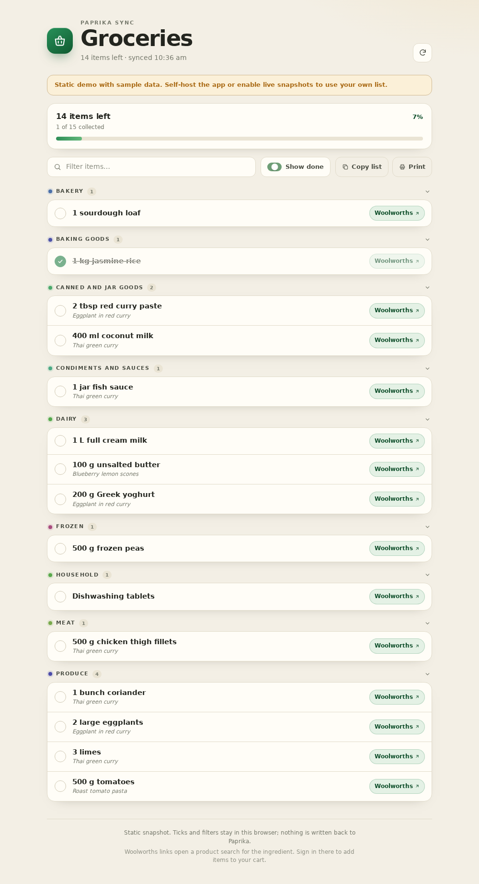

# Paprika Groceries

A small grocery-list portal for [Paprika Recipe Manager](https://www.paprikaapp.com/). It reads your Paprika grocery list and gives every ingredient a one-tap **Woolworths** product search. Built with Bun and plain HTML/CSS/JS.



## Features

- Reads the default Paprika grocery list through Paprika Cloud Sync.
- Groups items by Paprika aisle, with the source recipe shown underneath.
- Opens `woolworths.com.au/shop/search/products?searchTerm=…` using Paprika's canonical ingredient name (`eggplant`, not `2 large eggplants`).
- Local tick-offs, “show done”, filtering, copy-as-text, and printing.
- Mobile-friendly shopping layout.
- Server-side credentials: your Paprika password never reaches the browser.
- Optional static GitHub Pages build for a public demo or snapshot.

## Quick start

Requires Bun 1.3 or newer.

```sh
bun install
cp .env.example .env
# edit .env with your Paprika email and password
bun run start
```

Open <http://127.0.0.1:8787>.

To bind on the LAN, set `HOST=0.0.0.0`. There is no web login, so only do that on a trusted network or behind a reverse proxy.

## Configuration

| Variable | Default | Purpose |
| --- | --- | --- |
| `PAPRIKA_EMAIL` | — | Paprika account email |
| `PAPRIKA_PASSWORD` | — | Paprika account password |
| `PORT` | `8787` | HTTP port |
| `HOST` | `127.0.0.1` | Bind address |
| `CACHE_SECONDS` | `60` | Server-side grocery cache lifetime |
| `PAPRIKA_MOCK` | unset | `1` serves sample data without credentials |

The login token is cached at `.cache/paprika-token.json` (mode `0600`) and refreshed automatically on a 401.

## Docker

```sh
docker build -t paprika-groceries .
docker run --rm -p 8787:8787 --env-file .env paprika-groceries
```

The container listens on `0.0.0.0`, so put it behind a reverse proxy if it is exposed beyond your LAN.

## GitHub Pages

GitHub Pages is **public**. The included workflow builds the static portal with **sample data by default**, which is safe to publish.

To publish your actual list, set the repository variables/secrets below and accept that anyone with the Pages URL can read your grocery list:

1. Repository **secret** `PAPRIKA_EMAIL`
2. Repository **secret** `PAPRIKA_PASSWORD`
3. Repository **variable** `PUBLISH_REAL_LIST=true`

The Pages workflow then runs `bun run build:static:live`; otherwise it runs the sample build. The generated page contains the list data inline and requires no server at runtime. The static page has local tick-offs and Woolworths search links, but cannot call Paprika live from the browser: Paprika's API does not send CORS headers. To refresh a live snapshot, re-run the workflow (or add a `schedule` trigger to `.github/workflows/pages.yml`).

The static page is marked `noindex` and ships a `robots.txt` disallow rule, but that is not access control. **Self-host the Bun server for a private list.**

## How the API works

Paprika has no official public API. This uses the same unofficial Cloud Sync endpoints as the apps:

- `POST /api/v1/account/login/` — email/password login, returns a bearer token.
- `GET /api/v2/sync/grocerylists/` — grocery lists.
- `GET /api/v2/sync/groceries/` — grocery items.

Requests are server-side. Soft-deleted items are filtered, responses are cached for 60 seconds, and a token is cached at `.cache/paprika-token.json`. The app is read-only: it only calls login and GET endpoints. Ticks stay in `localStorage`; nothing is written back to Paprika. Woolworths links open their product search; adding to a cart happens on Woolworths after signing in there.

The unofficial API can change or rate-limit clients. Keep the cache enabled and avoid aggressive polling.

## Development

```sh
bun run check          # TypeScript
bun test               # unit tests
PAPRIKA_MOCK=1 bun run start
bun run build:static   # sample-data static site in dist/
bun run build:static:live  # requires PAPRIKA_EMAIL / PAPRIKA_PASSWORD
```

## Licence

MIT. Not affiliated with Hindsight Labs or Woolworths.
